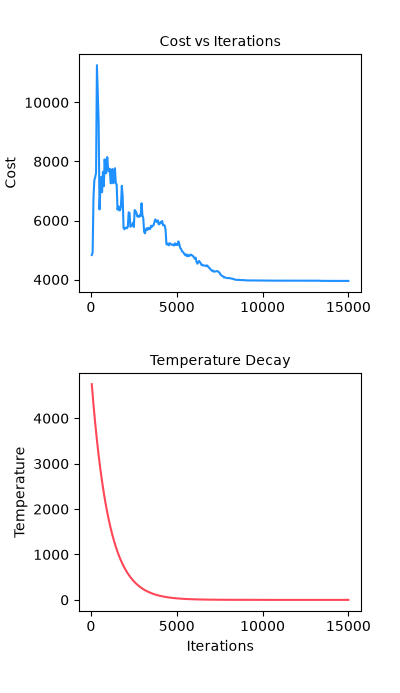

# SiliconMap

**SiliconMap** is an interactive VLSI floorplanning and placement optimization tool written in Python (`Tkinter` + `matplotlib`). It models and optimizes physical layout constraints on a silicon die using **Simulated Annealing**, finding the physical "sweet spot" between **interconnect propagation delay (latency)**, **thermal dissipation**, **routing congestion**, **die boundary limits**, and **wirelength**.



---

## 🌟 Key Features

* **⏱️ Interconnect Delay Modeling & Monitoring (Elmore $RC$ Model):**  
  Calculates signal propagation delay across interconnects in picoseconds ($ps$) using Bakoglu's distributed $RC$ formulation. Real-time critical path identification highlights latency bottlenecks directly on the canvas.
* **🔥 Thermal Hotspot Management:**  
  Penalizes spatial clustering of high-power components ($\propto \frac{P_i \cdot P_j}{\text{dist}}$) to prevent localized overheating.
* **⚡ Multi-Objective Placement Optimization:**  
  Simulated Annealing engine driven by dynamic temperature cooling and adaptive step-size scaling to simultaneously resolve overlaps, wirelength, congestion, out-of-bounds, and delay penalties.
* **📊 Real-Time Analytics:**  
  Synchronized three-tier Matplotlib analytics plotting **Total Cost**, **Critical Path Delay ($ps$)**, and **Temperature Decay** across iterations.
* **📐 Physical Feasibility Checker:**  
  2D shelf-packing heuristic and geometric bounds ensure components physically fit within die dimensions before optimization, suggesting minimal viable die sizes when packed too tightly.
* **🎨 Interactive CAD Canvas:**  
  Smooth mouse-wheel zoom, panning, block drag-and-drop, corner-handle mouse resizing, 90° rotation, heat-map toggle, and on-wire timing latency tags.
* **📦 Component Library + Custom Blocks:**  
  Includes 15 built-in VLSI macro blocks (`ALU`, `FPU`, `CTRL`, `DECODER`, `REG`, `CACHE`, `RAM`, `ROM`, `MUX`, `DMA`, `UART`, `GPIO`, `ADC`, `PLL`, `PMU`) plus full support for user-defined dimensions and power ratings.

---

## 🔬 The VLSI Physics: Finding the "Sweet Spot"

In modern microchip physical design, two opposing physical forces govern macro and standard block placement:

```
          [Blocks Too Far Apart]                               [Blocks Too Close]
      ------------------------------                       ---------------------------
      • Low thermal coupling                              • Severe thermal hot spots (P₁·P₂ / dist)
      • High interconnect latency (L + L²)                • High routing congestion
      • Violates timing constraints                       • Lower interconnect latency
```

1. **Interconnect Delay (Attraction):**  
   As relative distance $L$ increases, interconnect latency rises superlinearly due to wire resistance and distributed capacitance:
   $$\tau = R_{\text{driver}} \cdot C_{\text{load,tot}} + \left(R_{\text{driver}} \cdot c_0 + r_0 \cdot \frac{C_{\text{load,tot}}}{N_{\text{sinks}}}\right) L + \frac{1}{2} r_0 c_0 L^2$$
   To satisfy clock frequency budgets ($f_{\max} = 1 / T_{\text{clk}}$), connected blocks are pulled closer together.

2. **Thermal Dissipation (Repulsion):**  
   Concentrating high-power components creates intense thermal hotspots:
   $$\text{Penalty}_{\text{thermal}} = \sum_{i < j} \frac{P_i \cdot P_j}{\text{dist}(i, j)}$$
   This pushes power-heavy macros apart to spread thermal dissipation evenly across the substrate.

3. **The Equilibrium:**  
   SiliconMap balances these forces inside the multi-objective cost function:
   $$\text{Cost} = \text{HPWL} + 2000 \cdot \text{Overlap} + 50 \cdot \text{Congestion} + 3000 \cdot \text{OutOfBounds} + 10 \cdot \text{Thermal} + 25 \cdot \text{Delay}$$
   The annealer converges on the **sweet spot**: timing-critical blocks remain tightly coupled while high-heat components retain sufficient clearance.

### Theoretical Citations
* **Elmore, W. C.** (1948). *"The Transient Response of Damped Linear Networks with Particular Regard to Wideband Amplifiers"*, **Journal of Applied Physics**, 19(1): 55–63.
* **Bakoglu, H. B.** (1990). *"Circuits, Interconnections, and Packaging for VLSI"*, Addison-Wesley.
* **Koide, T., & Wakabayashi, S.** (1999). *"A timing-driven floorplanning algorithm with the Elmore delay model for building block layout"*, **Integration: The VLSI Journal**, 28(1): 57–75.

---

## 🚀 Getting Started

### Prerequisites
- Python 3.8+
- Tkinter (included with Python on Windows and macOS; on Ubuntu/Debian run `sudo apt install python3-tk`)
- `matplotlib`

### Installation

```bash
# Clone the repository
git clone https://github.com/Tanish225/SiliconMap.git
cd SiliconMap

# Create and activate virtual environment
python -m venv venv
source venv/bin/activate       # On Windows: venv\Scripts\activate

# Install dependencies
pip install matplotlib

# Launch SiliconMap
python -m app.main
```

---

## 🎮 Usage Guide

1. **Set Initial Die Size:**  
   Configure chip width and height on startup (presets or custom size in $\mu m$).
2. **Add Components:**  
   Select standard macros from the **Components** sidebar tab, or click **Custom component...** to define unique dimensions and power dissipation.
3. **Edit & Wire Components:**  
   - Click a block to inspect or edit name, width, height, and power in the sidebar.
   - Drag the **blue corner handle** on the canvas to resize blocks interactively.
   - Click **Connect** to route a net between two components.
4. **Configure & Optimize:**  
   - Switch to the **Chip & Run** tab.
   - Adjust initial temperature, cooling rate, iterations, and 90° rotation.
   - Toggle **Optimize timing delay (Elmore RC)**.
   - Click **▶ Run Optimizer**.
5. **Analyze Timing & Placement:**  
   - Toggle **Delay / Timing** on the toolbar to display latency values per wire and highlight the critical path net in crimson (`(CRIT)`).
   - Inspect the real-time cost, critical delay ($ps$), and temperature decay curves.
   - Read the **Layout metrics** panel for legality, wirelength, congestion, thermal score, and worst-case slack.
6. **Save / Load:**  
   Export the optimized layout JSON (with per-net latency and die coordinates) and plot graph PNG.

---

## ⌨️ Controls & Shortcuts

| Action | Control |
|---|---|
| **Zoom in / out** | Mouse Wheel or `＋` / `－` toolbar buttons |
| **Pan die** | Left-Click & Drag empty canvas space |
| **Move block** | Left-Click & Drag block |
| **Resize block** | Drag the blue square handle on the bottom-right corner |
| **Rotate block** | Click **Rotate** button in sidebar |
| **Delete block** | Select block and press `Delete` key (or sidebar button) |
| **Fit to screen** | Click **Fit** toolbar button |

---

## 📁 Repository Structure

```
SiliconMap/
├── app/
│   ├── algorithms/
│   │   ├── __init__.py
│   │   └── annealing.py       # Simulated Annealing placement engine
│   ├── core/
│   │   ├── __init__.py
│   │   ├── feasibility.py     # 2D packing & die constraint feasibility checks
│   │   ├── library.py         # Standard component catalog (dimensions, power, colors)
│   │   ├── models.py          # Core domain dataclasses (Block, Net, Floorplan)
│   │   └── parser.py          # JSON floorplan loader & schema validator
│   ├── metrics/
│   │   ├── __init__.py
│   │   ├── cost.py            # Multi-objective placement cost functions
│   │   └── delay.py           # Elmore RC interconnect delay model & timing stats
│   ├── ui/
│   │   ├── __init__.py
│   │   ├── dialogs.py         # Startup die sizing & custom block modals
│   │   └── visualizer.py      # Interactive Tkinter canvas & Matplotlib analytics
│   ├── __init__.py
│   └── main.py                # Main application entry point & orchestration
├── sample_chip.json           # Sample floorplan specification
├── optimized_layout.json      # Example exported floorplan with timing metadata
├── cost_graph.png             # Example exported optimization trajectory
└── README.md                  # Project documentation
```

---

## 📄 Floorplan JSON Format

SiliconMap saves and loads layout configurations using human-readable JSON:

```json
{
    "chip_width": 400.0,
    "chip_height": 400.0,
    "metrics": {
        "max_delay_ps": 9.62,
        "avg_delay_ps": 6.84,
        "critical_net": "ALU_to_Regs"
    },
    "blocks": [
        {
            "name": "ALU_1",
            "kind": "ALU",
            "x": 20.0,
            "y": 20.0,
            "width": 120.0,
            "height": 100.0,
            "power_watts": 80.0
        }
    ],
    "nets": [
        {
            "name": "ALU_to_Cache",
            "blocks": ["ALU_1", "CACHE_1"],
            "delay_ps": 4.17
        }
    ]
}
```

---

## 🛡️ License

This project is licensed under the MIT License. Contributions and feedback are welcome!
